# Token 自由攻略（持续更新）

> 在线阅读：<https://wangxinhan.cn/tokenfree/>　·　PDF 原版：[tokenfree-guide.pdf](tokenfree-guide.pdf)

本攻略旨在分享**稳定好用的大模型智能体词元来源**，减小信息差，长期更新，欢迎大家点赞评论转发，拿走不谢！

- 欢迎大家在[评论区](https://wangxinhan.cn/tokenfree/#comments)留下你知道的更多免费 token 渠道，有疑问建议也可以评论区交流！
- 欢迎大家通过提 [issue](https://github.com/XinhanWang/tokenfree/issues/new) 或者 [PR](https://github.com/XinhanWang/tokenfree/pulls) 提交渠道，共同维护！
- 推荐**先优先使用公益站的免费额度**，不够再使用低价稳定的付费中转站。
- 中转站都是**官方满血模型**，不需要担心降智的问题！

> 各渠道的注册链接为**邀请 / 推广链接**，通过它注册通常双方都能拿到一点额度奖励，对你没有额外成本；如果不希望走推广，直接搜索官网注册同样可用。

---

## 官方 Agent 工具

### Trae Code 和 Trae Work

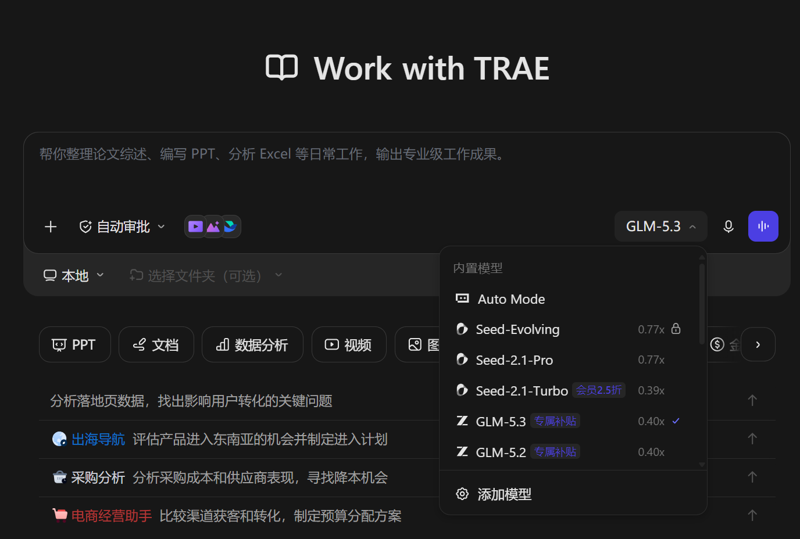

Trae 是字节旗下的 Agent 产品，[Trae Code](https://www.trae.cn/ide)（原 Trae IDE，2026 年 8 月更名）面向程序员，是专业的 AI 编程工具。[Trae Work](https://www.trae.cn/work-fission/BWMBDDTW44NT?utm_source=copy_link&utm_medium=friends_invite) 是 AI 工作助手。能免费用上顶尖的国产大模型。

Trae Code 排队很严重，Trae Work 排队一般几分钟，还能接受。建议选择 Deepseek v4 flash 正式版或者 GLM5.3，性价比高。

8 月改成积分制的了，每天签到领取积分。

---

## 低价稳定的付费中转站

### [AIHub](https://aihub.top/register?aff=56323S4F7BBN)（全时段稳定可用）

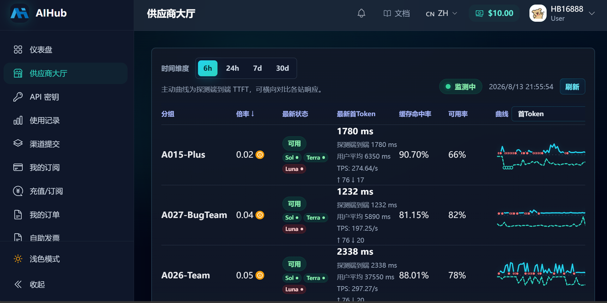

聚合全网的 GPT 中转站渠道，挑**倍率低**而且**可用**稳定的分组使用。

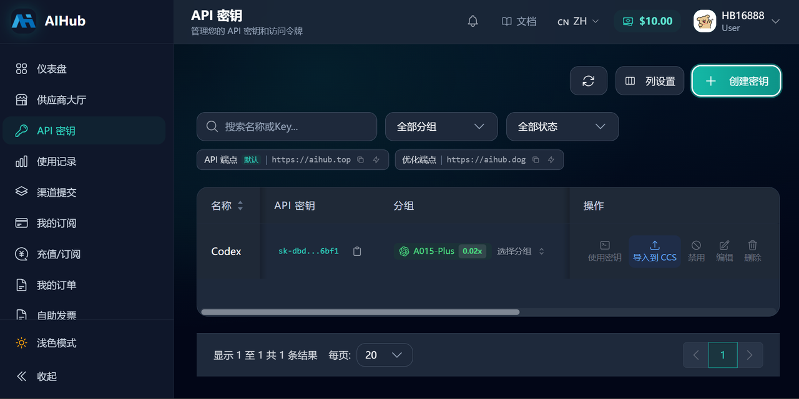

创建 API Key，需要选择对应的分组。

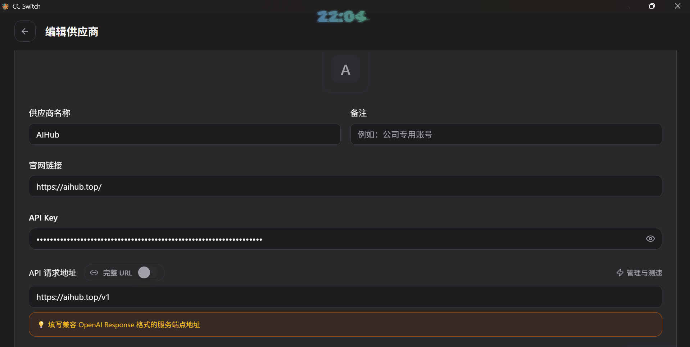

在 cc switch 里面配置 API Key 和请求地址。**重启** ChatGPT 客户端之后就可以用了。

### [君的星辰](https://ai.centos.hk/register?aff=5JZ8)（全时段稳定可用）

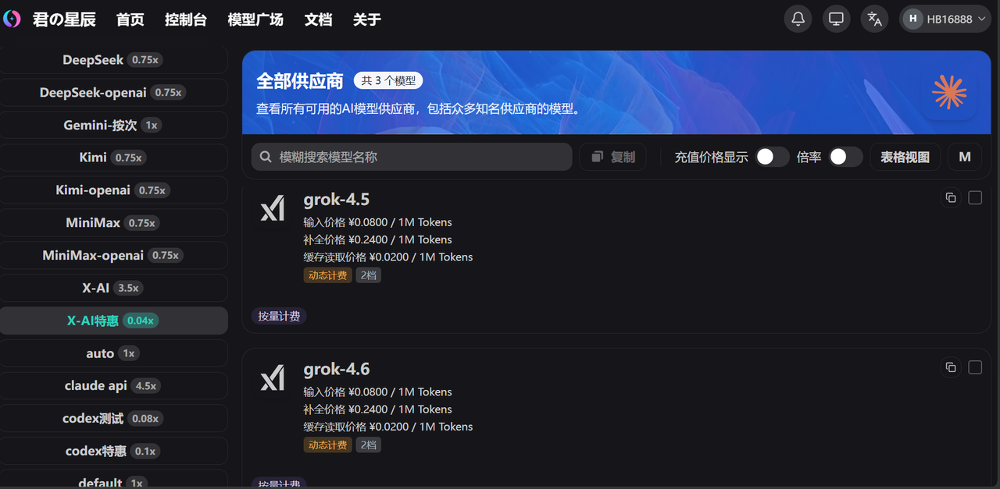

GPT 系列模型和其他模型都有特惠渠道，Grok 4.6 很便宜了。

---

## 无需 L 站账号登录的公益站

> 这几家都卡 **GitHub 账号注册年限**。没有老号的话，去闲鱼花 15 RMB 左右就能买一个，属于一次性投入。

### [JustDoWork](https://api.justwoker.icu/register?aff=yvly)（全时段稳定可用）

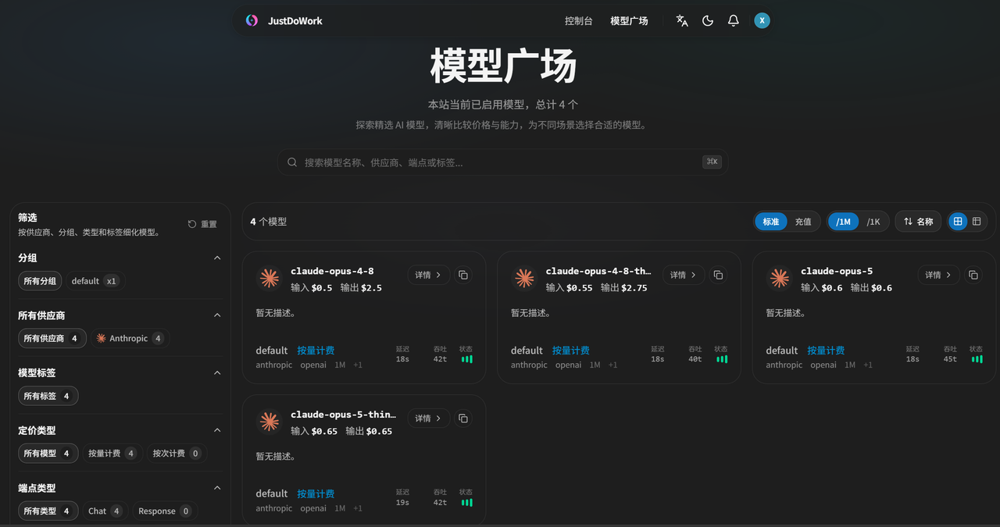

需要一年以上的 Github 账号注册（没有可以去闲鱼花 15 RMB 买一个），每天签到有二十到三十刀。推荐使用 claude-opus-5-thinking。

### [KK token](https://kktoken.cc/sign-up?aff=VnCt)（全时段稳定可用）

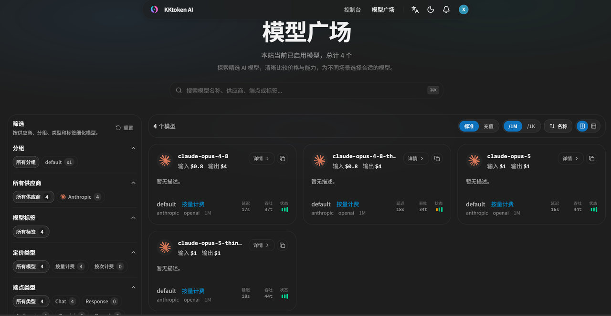

需要一年以上的 Github 账号注册（没有可以去闲鱼花 15 RMB 买一个），每天签到有 20 刀。推荐使用 claude-opus-5-thinking。

### [Agent Router](https://agentrouter.org/register?aff=97Vc)（绝大部分时段稳定可用）

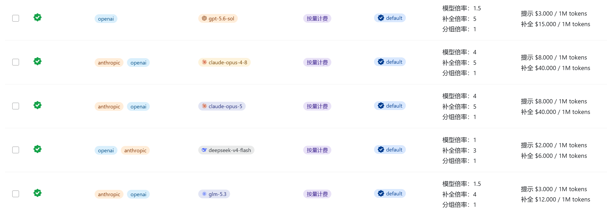

需要用 25 年 12 月之前的 Github 账号或者 L 站账号注册登录，每天签到 25 刀额度（退出登录再重新登录就自动签到了，有两个号的话可以领取两遍）。

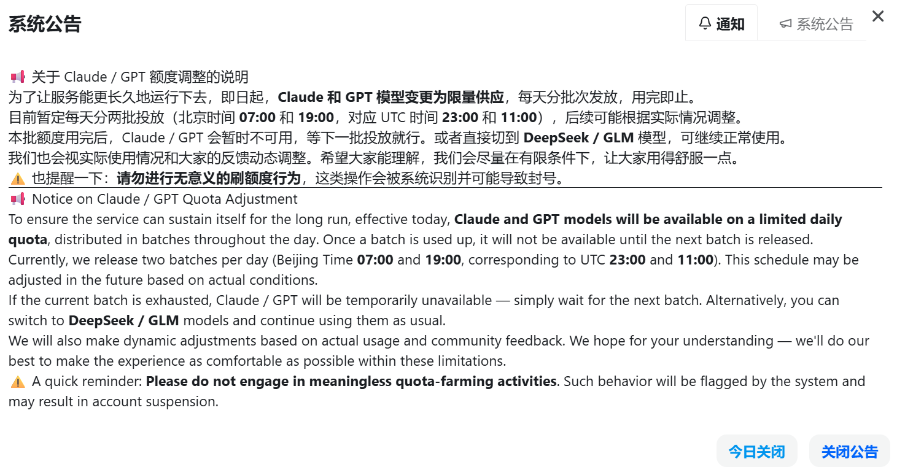

Claude 和 GPT 模型现在改成了限量供应，日常可以使用国产模型 Deepseek v4 flash 和 GLM5.3。

### [Rawchat](https://new.sharedchat.cc/list/#/register?i=8MU5T)（小部分时段稳定可用）

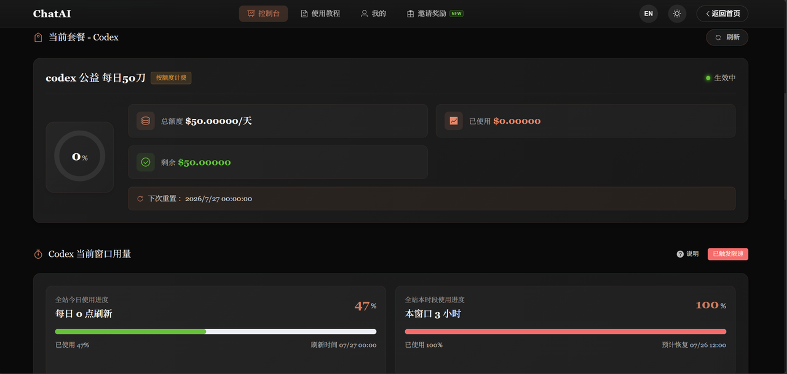

长期稳定，支持 GPT 系列模型，在 Codex 里面使用，每天有 50 刀额度，3 小时限额 15 刀。缺点是全站的窗口限额太少了，全站的窗口满了就用不上了。

---

## 需要 L 站账号登录的公益站

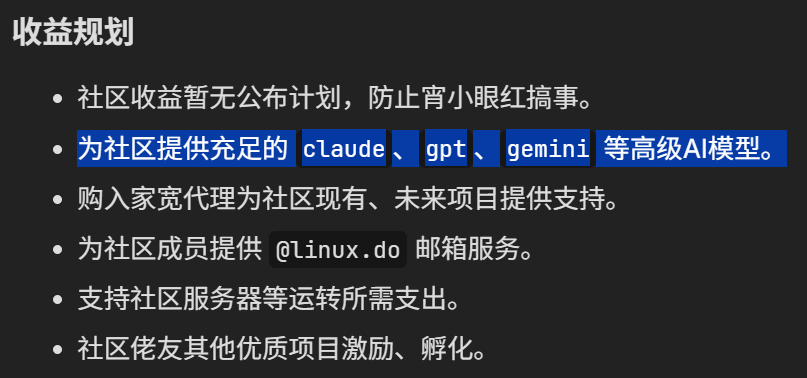

L 站上有很多大模型公益站的羊毛，需要有 L 站账号才能薅到。看上游渠道的账号，号多的时期就能**爽用**，号少的时期也能维持正常使用。

### 如何注册 L 站账号

如果有五年以上 Github 账号的话，可以直接[官方注册](https://invite.linuxdo.org/)。

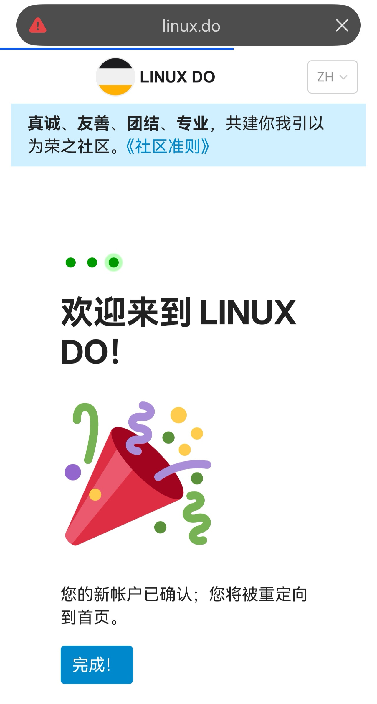

没有的话去闲鱼买高级邀请码，就可以邮箱注册了。

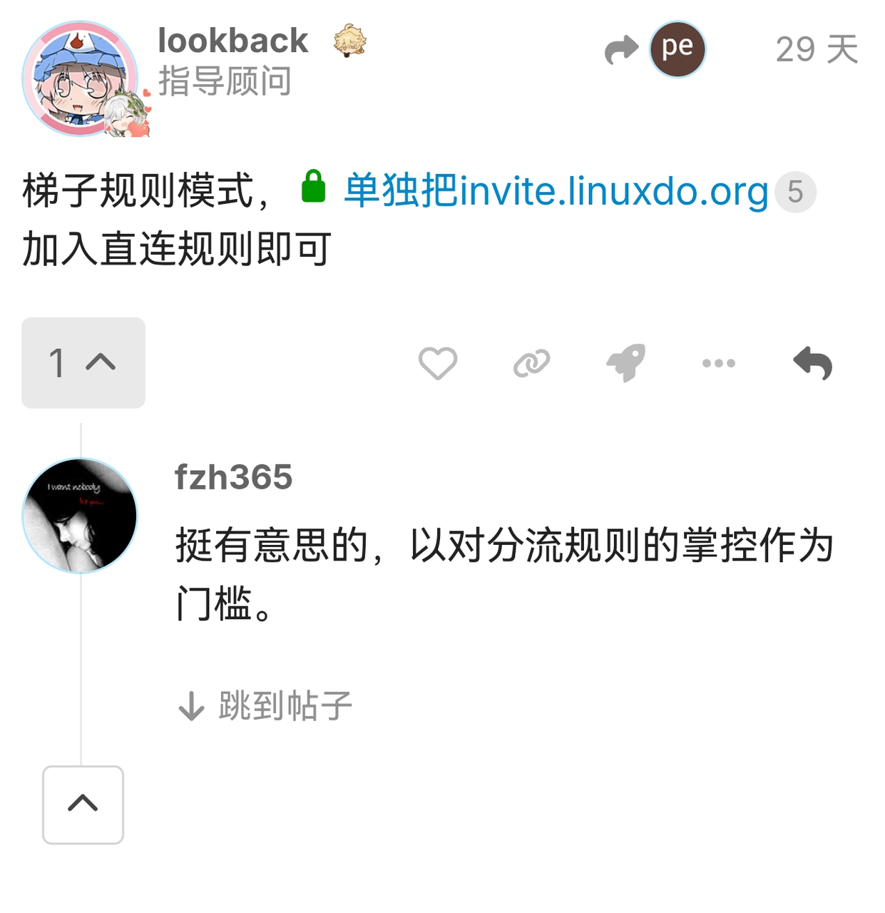

注册页打不开的话，梯子规则模式下把 `invite.linuxdo.org` 单独加入直连规则即可。

### [Anyrouter](https://anyrouter.top/register?aff=EiOD)（绝大部分时段稳定可用）

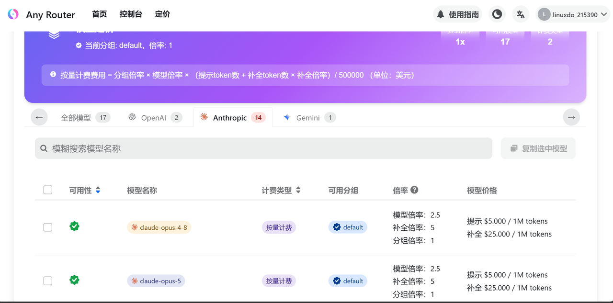

每天签到 25 刀额度，GPT 系列模型没有 Claude 系列稳定，一般挤不上，推荐优先使用 Opus 5。

---

## 如何在 Agent 工具里面使用公益站的 API

下载安装 [cc-switch](https://github.com/farion1231/cc-switch/releases)。

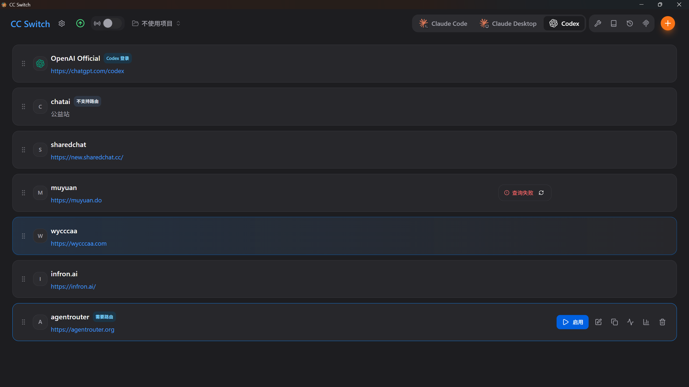

在右上方选择对应的平台，比如 Claude Desktop 和 Codex。

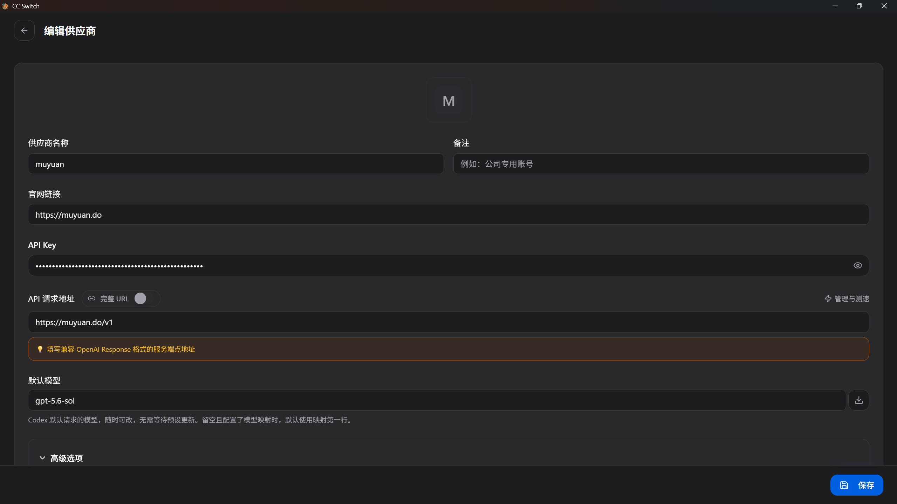

填写相关的配置，主要修改 API Key 和 API 请求地址。注意两类客户端的请求地址写法不一样：

- **Codex 里面要加 `/v1`**，例如 `https://xxx.com/v1`。
- **Claude 里面不加**，直接填到域名为止，例如 `https://xxx.com`。

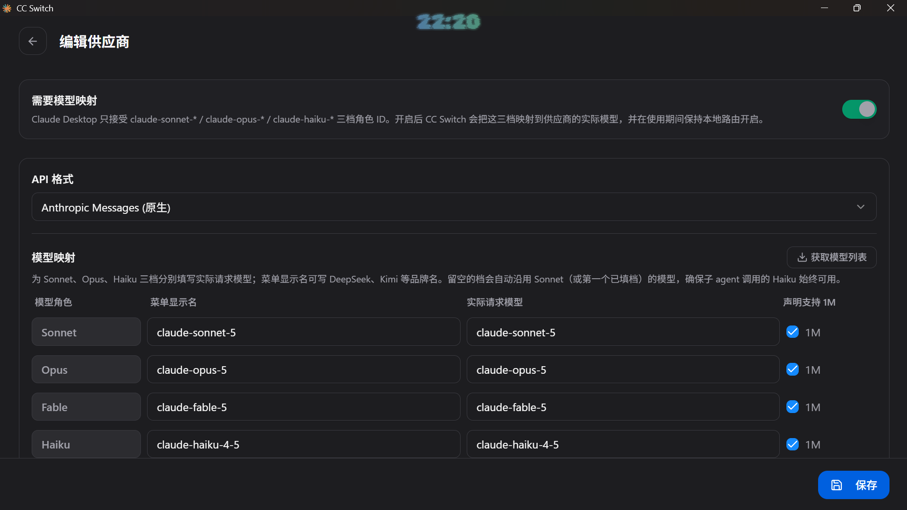

如果不是平台默认对应的模型，比如 kimi-k3 接入的时候需要修改模型映射。Claude 系列模型需要声明 1M 上下文。

保存切换之后，关闭重新打开 Agent 工具，就能正常使用了，报错的话再根据错误提示进行分析。

---

## 免责声明

内容整理自个人实测，各站的额度、限流与可用性随时可能调整，请以对应官网公告为准。本站不售卖任何服务，也不为第三方站点的可用性与安全性背书。

