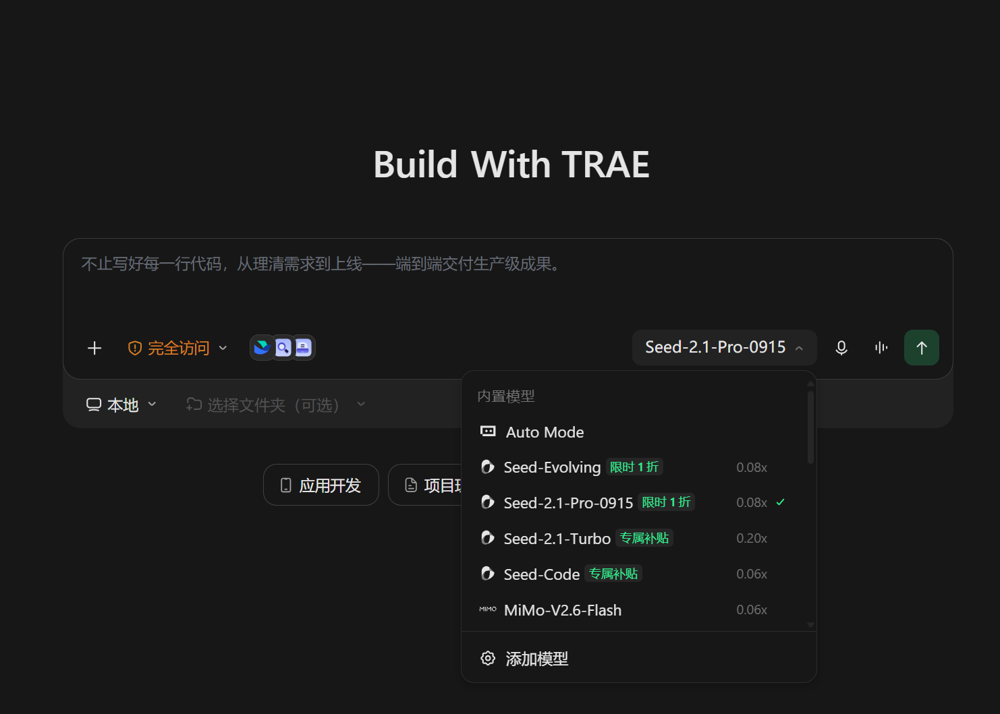
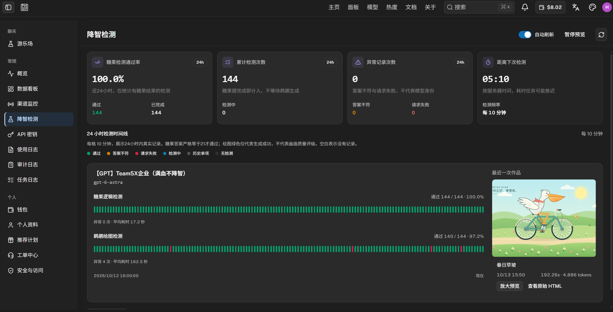

# Token 自由攻略（持续更新）

> 在线阅读：<https://wangxinhan.cn/tokenfree/>　·　PDF 最新版：[tokenfree-guide.pdf](tokenfree-guide.pdf)

**更新日期：2026-10-13**

本攻略旨在分享**稳定好用的大模型智能体词元来源**，减小信息差，长期更新，欢迎大家点赞评论转发，拿走不谢！

- 欢迎大家在[评论区](https://wangxinhan.cn/tokenfree/#comments)留下你知道的更多免费 token 渠道，有疑问建议也可以评论区交流！
- 欢迎大家通过提 [issue](https://github.com/XinhanWang/tokenfree/issues/new) 或者 [PR](https://github.com/XinhanWang/tokenfree/pulls) 提交渠道，共同维护！

Claude 和 GPT 加强了风控，**中转站 Token 狂欢时代暂时结束了，期待下一次狂欢。**

现在免费公益站能稳定使用的顶级模型已经很少，推荐使用**低价稳定、满血不降智的付费中转站**，选择 **GPT 6.1 Sol** 等高性价比模型作为日常主力。公益额度与官方工具签到积分作为补充。

> 各渠道的注册链接为**邀请 / 推广链接**，通过它注册通常双方都能拿到一点额度奖励，对你没有额外成本；如果不希望走推广，直接搜索官网注册同样可用。

---

## 官方 Agent 工具

### [Trae CN](https://www.trae.cn/events/code-fission/EX68HKT3CXFR?utm_source=copy_link&utm_medium=code_fission)

**Trae Code 和 Trae Work 已经合并成 Trae CN**，编程与日常工作统一到同一个产品里。

免费账户**每天签到可领取 100 积分**。推荐使用 **MiMo-V2.6-Pro** 等性价比高的模型，按任务难度分配积分。

截图展示了 Seed 系列和 MiMo-V2.6-Flash；本文日常推荐 MiMo-V2.6-Pro。

---

## 低价稳定的付费中转站

### [智纽](https://ai.apizn.com/sign-up?aff=oBe3)（低价、相对稳定）

推荐使用 **0.15 倍的 GPT Team 5* 分组**，满血不降智，使用也比较稳定。**GPT 6.1 Sol 性价比很高，可以当作日常编程与 Agent 任务的主力模型。**

智纽提供**降智检测**，可查看逻辑检测、绘图检测和异常记录。截图中的测试模型是 **gpt-6-astra**：近 24 小时逻辑检测通过 **144 / 144（100.0%）**，绘图生成通过 **140 / 144（97.2%）**。这只是当时的检测记录，不能代表所有模型或未来可用性。

创建 API Key 时选择对应的分组，再通过 cc-switch 配置 API Key 和请求地址。

---

## 无需 L 站账号登录的公益站

### [Agent Router](https://agentrouter.org/register?aff=97Vc)（限量供应）

需要用 **2025 年 12 月之前的 GitHub 账号或者 L 站账号**注册登录，每天签到 **25 刀额度**。

截图列出 gpt-6-astra、claude-opus-4-8、claude-opus-5 和 deepseek-v4-flash。输入 / 输出价格（美元每百万 tokens）分别为 **8 / 40、8 / 40、6 / 30、4 / 12**。日常可以尝试 deepseek-v4-flash，顶级模型仍受资源限制。

- 资源投放由三批改回**每天两批**：北京时间 **10:00、19:00**，对应 UTC **02:00、11:00**。每批可用时间有限，用完等下一批。
- **非编程用途或使用不支持的客户端**会被放入 **probation 分组**，**倍率翻倍**，规则动态更新。请按站点支持的方式使用。
- 支持的客户端包括 **claude-code、codex**，以及 openclaw、pi、opencode、ohmyopencode、kilo-code、roocode、cline、crush、droid、qwencode、hermes、zcode、qoder、kimi code、craft-agent、trae、github-copilot、workbuddy、cursor、deepseek-harness、mimo-code。

### [Rawchat](https://new.sharedchat.cc/list/#/register?i=8MU5T)（小部分时段稳定可用）

支持 GPT 系列模型，在 Codex 里面使用，每天有 50 刀额度，3 小时限额 15 刀。缺点是全站的窗口限额太少了，全站的窗口满了就用不上了。

---

## 需要 L 站账号登录的公益站

L 站（linux.do）账号可用于登录相关公益站。当前顶级模型供应受上游风控影响，公益额度适合作为补充，使用前查看站点公告。

### 如何注册 L 站账号

如果有五年以上 Github 账号的话，可以直接[官方注册](https://invite.linuxdo.org/)。

没有的话去闲鱼买高级邀请码，就可以邮箱注册了。

注册页打不开的话，梯子规则模式下把 `invite.linuxdo.org` 单独加入直连规则即可。

### [Anyrouter](https://anyrouter.top/register?aff=EiOD)（公益额度补充）

每天签到 **25 刀额度**，推荐优先使用 **claude-opus-5-5**。GPT 系列通常没有 Claude 系列稳定，顶级模型可用性随上游资源变化。

截图中 claude-opus-5-5 的 **default 分组倍率为 1、模型倍率为 2、补全倍率为 5**；输入 **$4 / 1M tokens**，输出 **$20 / 1M tokens**。

---

## 如何在 Agent 工具里面使用公益站的 API

下载安装 [cc-switch](https://github.com/farion1231/cc-switch/releases)。

在右上方选择对应的平台，比如 Claude Desktop 和 Codex。

填写相关的配置，主要修改 API Key 和 API 请求地址。注意两类客户端的请求地址写法不一样：

- **Codex 里面要加 `/v1`**，例如 `https://xxx.com/v1`。
- **Claude 里面不加**，直接填到域名为止，例如 `https://xxx.com`。

如果不是平台默认对应的模型，比如 kimi-k3 接入的时候需要修改模型映射。Claude 系列模型需要声明 1M 上下文。

保存切换之后，关闭重新打开 Agent 工具，就能正常使用了，报错的话再根据错误提示进行分析。

---

## 免责声明

内容整理自个人实测，各站的额度、限流与可用性随时可能调整，请以对应官网公告为准。本站不售卖任何服务，也不为第三方站点的可用性与安全性背书。

